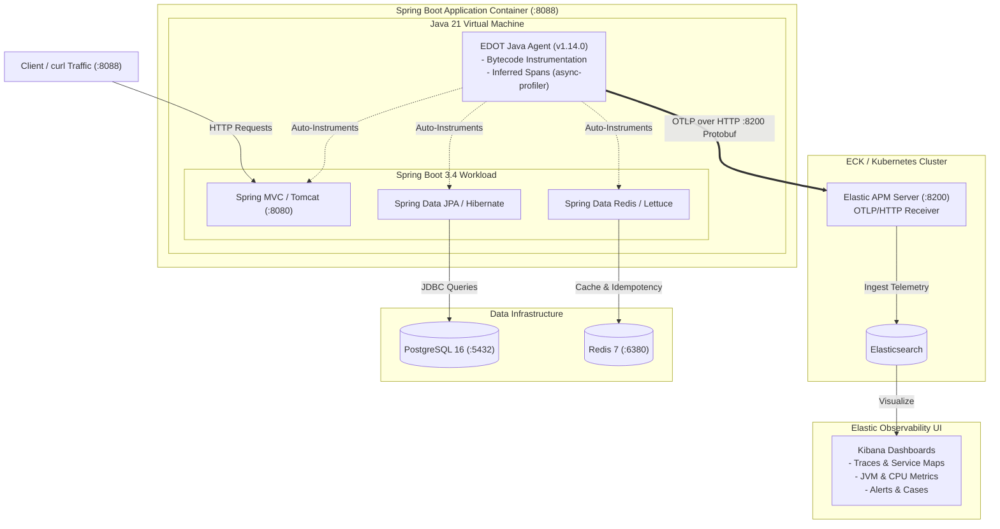

# Spring Boot + Elastic Distribution of OpenTelemetry (EDOT) APM

A production-ready reference architecture demonstrating how to instrument a modern **Spring Boot 3.4 (Java 21 LTS)** application using the **Elastic Distribution of OpenTelemetry (EDOT) Java Agent v1.14.0**, shipping distributed traces, metrics, and logs to **Elastic APM & Elasticsearch (ECK)**.

This repository focuses on **enterprise APM integration, observability workflows, and failure alerting**, using a containerized multi-tier application (PostgreSQL + Redis + Spring Security) as a realistic workload generator.

---

## Observability Architecture



---

## Key Observability Highlights

- **Zero-Code Java Instrumentation:** 100% bytecode auto-instrumentation via `-javaagent:/app/elastic-otel-javaagent.jar`. No proprietary APM SDK code in application classes.
- **Full Distributed Tracing:** Automatically tracks end-to-end spans across incoming HTTP endpoints, Spring Data JPA / Hibernate SQL queries, and Redis Lettuce commands.
- **Deep CPU Profiling (Inferred Spans):** Native `async-profiler` integration automatically samples CPU call stacks on slow traces without manual instrumentation.
- **Environment Separation:** Segment metrics and traces in Kibana using `deployment.environment=development|staging|production`.
- **ECK (Elastic Cloud on Kubernetes) Compatibility:** Direct OTLP integration with self-managed ECK APM Server over plain HTTP or TLS.
- **Failure Alerting & Incident Cases:** Real-world playbook for capturing database connection timeouts (`HikariPool`) and auto-triggering alerts in Kibana.

---

## Quick Setup

Get the entire stack (Spring Boot App + PostgreSQL + Redis + EDOT APM Agent) running in minutes:

### 1. Configure Environment
Create your local `.env` configuration file from the template:
```bash
cp .env.example .env
```

### 2. Set APM Server Details in `.env`
Update the Elastic APM Server endpoint and credentials in `.env`:
```env
# Enable APM exporter
OTEL_SDK_DISABLED=false

# APM Server URL (HTTP port 8200)
OTEL_EXPORTER_OTLP_ENDPOINT=http://<YOUR_APM_SERVER_IP>:8200

# APM Secret Token
OTEL_EXPORTER_OTLP_HEADERS='Authorization=Bearer <YOUR_APM_TOKEN>'
```
*(Tip: Set `OTEL_SDK_DISABLED=true` if developing offline without an APM Server).*

### 3. Build & Start the Containers
```bash
docker compose up -d --build
```

### 4. Verify & Generate APM Telemetry
Run the automated verification suite to execute 13 transactions and verify system health:
```bash
./verify-api.sh
```

### 5. View in Kibana
Navigate to **Kibana** (`https://<KIBANA_HOST>:5601`) ➔ **Observability** ➔ **APM** ➔ **Services** ➔ **`payment-gateway-api`** to view your real-time traces, service maps, and JVM metrics.

---

## EDOT Agent Implementation Details

### 1. Multi-Stage Container Setup ([`Dockerfile`](file:///home/vikram/github/spring-boot-edot-apm/Dockerfile))

The agent is downloaded directly from Maven Central during Docker image build and attached to the JVM startup:

```dockerfile
# Stage 2: Runtime image
FROM eclipse-temurin:21-jre-alpine
WORKDIR /app

# Download official Elastic Distribution of OpenTelemetry (EDOT) Java Agent v1.14.0
ADD https://repo1.maven.org/maven2/co/elastic/otel/elastic-otel-javaagent/1.14.0/elastic-otel-javaagent-1.14.0.jar /app/elastic-otel-javaagent.jar

COPY --from=build /app/target/*.jar app.jar

# Attach agent via JVM flag
ENTRYPOINT ["java", "-javaagent:/app/elastic-otel-javaagent.jar", "-XX:+UseContainerSupport", "-XX:MaxRAMPercentage=75.0", "-jar", "app.jar"]
```

---

### 2. APM Environment Configuration ([`.env`](file:///home/vikram/github/spring-boot-edot-apm/.env))

All agent settings are configured dynamically via environment variables without hardcoding:

```env
# ==========================================
# Elastic OpenTelemetry (EDOT) APM Configuration
# ==========================================
# Toggle APM telemetry on/off (set 'true' for offline local dev)
OTEL_SDK_DISABLED=false

# Service identifier shown in Kibana APM
OTEL_SERVICE_NAME=payment-gateway-api

# Environment tagging (drives the environment dropdown in Kibana)
OTEL_RESOURCE_ATTRIBUTES=deployment.environment=development,service.version=1.0.0

# OTLP endpoint of Elastic APM Server
OTEL_EXPORTER_OTLP_ENDPOINT=http://10.73.129.202:8200

# Bearer Token Authentication (must be HeaderName=HeaderValue)
OTEL_EXPORTER_OTLP_HEADERS='Authorization=Bearer <YOUR_APM_SECRET_TOKEN>'

# Exporters
OTEL_METRICS_EXPORTER=otlp
OTEL_LOGS_EXPORTER=otlp

# Enable deep CPU profiling on traces via async-profiler
OTEL_INFERRED_SPANS_ENABLED=true
```

---

## ECK (Elastic Cloud on Kubernetes) Integration Guide

To avoid managing self-signed TLS certificates and hostname verification mismatches on internal networks, configure the `ApmServer` custom resource in Kubernetes to receive plain HTTP traffic:

```yaml
# In apm-server.yaml
spec:
  http:
    tls:
      selfSignedCertificate:
        disabled: true
```

Then configure your application `.env`:
```env
OTEL_EXPORTER_OTLP_ENDPOINT=http://<APM_LOADBALANCER_OR_NODE_IP>:8200
```

---

## Environment Separation (Dev vs. Production)

Manage different target environments cleanly using OpenTelemetry tags and Spring profiles:

| Configuration | Development | Production |
|---|---|---|
| `APP_ENV` | `development` | `production` |
| `SPRING_PROFILES_ACTIVE` | `dev` | `prod` |
| `OTEL_SDK_DISABLED` | `false` (or `true` if no collector) | `false` |
| `OTEL_RESOURCE_ATTRIBUTES` | `deployment.environment=development` | `deployment.environment=production` |

In Kibana, switch between environments using the **Environment** dropdown at the top of every APM dashboard.

---

## Observability & Failure Simulation Playbook

### 1. Generating Baseline APM Traffic
Execute the end-to-end verification script to create realistic transactions (authentication, user profile, account deposits, payments, refunds):
```bash
./verify-api.sh
```
In Kibana (`Observability ➔ APM ➔ Services ➔ payment-gateway-api`), you will immediately see:
- Service throughput & response time percentiles (p50, p95, p99).
- Complete waterfall traces showing the HTTP request breaking down into JPA SQL queries and Redis operations.
- JVM runtime telemetry (Heap memory, non-heap, GC pause times, active thread count).

---

### 2. Testing Database Failure & Alert Rules

Simulate a production database outage and test incident alerting:

#### Step 1: Create the Alert Rule in Kibana
1. Navigate to **Observability ➔ Alerts ➔ Manage Rules ➔ Create rule**.
2. Select **KQL or Lucene** rule type.
3. Select your APM Data view (`traces-apm*`).
4. Set KQL Query:
   ```kql
   service.name: "payment-gateway-api" AND (error.exception.type: "*Timeout*" OR error.exception.message: "*HikariPool*" OR error.exception.message: "*Connection refused*")
   ```
5. Set condition: **`WHEN count() IS ABOVE 0 FOR THE LAST 1 minute`**.
6. Set Role visibility to **`Logs`** and click **Save**.

#### Step 2: Stop PostgreSQL
```bash
docker compose stop postgres
```

#### Step 3: Trigger Traffic
```bash
curl -i -X POST http://localhost:8088/api/v1/auth/login \
  -H "Content-Type: application/json" \
  -d '{"email":"test@example.com","password":"password123"}'
```

#### Step 4: Observe Alert & APM Traces
- **APM Error Log:** EDOT agent automatically captures `CannotGetJdbcConnectionException: HikariPool - Connection is not available, request timed out` with complete stack traces.
- **Kibana Alerts:** The rule triggers into **Fired** state within 60 seconds.
- **Elastic Cases:** Convert the active alert into an incident investigation ticket under **Observability ➔ Cases**.

#### Step 5: Recover
```bash
docker compose start postgres
```
The application reconnects to PostgreSQL via HikariCP self-healing, and the alert automatically resolves.

---

## Workload Application Quick Reference

The bundled workload is a sample Spring Boot application designed to exercise diverse telemetry signals:

| Component | Technology | Instrumented Signals |
|---|---|---|
| Web Layer | Spring MVC + Embedded Tomcat | Inbound HTTP spans, status codes, routes |
| Security | Spring Security 6 + JJWT | Filter chain latency, unauthorized 401 spans |
| Database | Spring Data JPA + PostgreSQL 16 | JDBC queries, transaction durations, connection pool |
| Cache | Spring Data Redis 7 (Lettuce) | Redis commands, cache hits/misses, idempotency |
| Runtime | Eclipse Temurin JDK 21 Alpine | Heap memory, thread states, CPU profiling |

### Starting the Cluster
```bash
# Copy example configuration
cp .env.example .env

# Start app, postgres, and redis
docker compose up -d --build

# Run verification suite
./verify-api.sh
```
