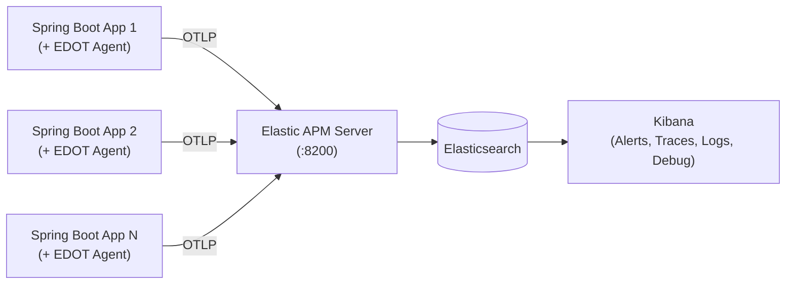

# Integrating Elastic APM (EDOT) with Java Spring Boot

This guide provides a complete reference for integrating the **Elastic Distribution of OpenTelemetry (EDOT) Java Agent** with a modern **Java 21 / Spring Boot 3+** application.

---

## 1. Overview & Architecture

The **Elastic Distribution of OpenTelemetry (EDOT) Java Agent** is an official extension of the upstream OpenTelemetry Java agent. It delivers:
- **Zero-Code Instrumentation:** Bytecode auto-instrumentation at JVM boot time (`-javaagent`). No code modifications or proprietary SDK imports are required in your Spring Boot application.
- **Unified Telemetry:** Automatically exports **Traces**, **Metrics**, and **Logs** via OpenTelemetry standard protocols (OTLP) to the Elastic APM Server or OpenTelemetry Collector.
- **Automatic Log-Trace Correlation:** Automatically injects `trace_id` and `span_id` into SLF4J / Logback logs and streams them to Elasticsearch.
- **Inferred Spans (Continuous Profiling):** Leverages an embedded `async-profiler` to sample CPU stack traces during long-running methods, creating virtual spans without manual code annotations.



---

## 2. Environment Variables Reference

The EDOT Java Agent is fully configured through standard OpenTelemetry environment variables:

| Environment Variable | Example Value | Description |
|---|---|---|
| `OTEL_SDK_DISABLED` | `false` | When set to `true`, completely disables the OpenTelemetry SDK and agent export. Useful for offline local development without an active APM Server. |
| `OTEL_SERVICE_NAME` | `payment-gateway-api` | Identifies the application name in Kibana APM, Service Maps, and Traces dashboards. |
| `OTEL_RESOURCE_ATTRIBUTES` | `deployment.environment=development,service.version=1.0.0` | Key-value pairs attached to every trace, metric, and log record. Used by Kibana to filter by environment (`development`, `staging`, `production`) and track version deployments. |
| `OTEL_EXPORTER_OTLP_ENDPOINT` | `http://<APM_SERVER_HOST>:8200` | Target OTLP collector URL. For Elastic APM Server, point to the OTLP/HTTP receiver port (typically `8200`). |
| `OTEL_EXPORTER_OTLP_HEADERS` | `Authorization=Bearer <APM_SECRET_TOKEN>` | Authentication headers passed with every OTLP export request. Elastic APM requires the format `Authorization=Bearer <secret-token>`. |
| `OTEL_METRICS_EXPORTER` | `otlp` | Exporter for JVM and application metrics (CPU, Heap, GC, Thread count). Set to `otlp` to ship to APM Server, or `none` to disable. |
| `OTEL_LOGS_EXPORTER` | `otlp` | Exporter for application logs. Set to `otlp` to enable automatic capture of SLF4J/Logback logs and export them to Elasticsearch. |
| `OTEL_INFERRED_SPANS_ENABLED` | `true` | Enables native CPU profiling using `async-profiler`. Automatically creates spans for internal methods that consume significant CPU execution time. |

---

## 3. Containerized Setup

### Dockerfile Snippet
In your Dockerfile, download the EDOT Java Agent and attach it to the Java process via the `-javaagent` flag:

```dockerfile
# ...
ADD https://repo1.maven.org/maven2/co/elastic/otel/elastic-otel-javaagent/1.14.0/elastic-otel-javaagent-1.14.0.jar /app/elastic-otel-javaagent.jar
# ...
ENTRYPOINT ["java", "-javaagent:/app/elastic-otel-javaagent.jar", "-XX:+UseContainerSupport", "-XX:MaxRAMPercentage=75.0", "-jar", "app.jar"]
# ...
```

### Docker Compose Snippet
Load your `.env` configuration file into the container using `env_file`:

```yaml
services:
  app:
    build:
      context: .
      dockerfile: Dockerfile
    ports:
      - "8088:8080"
    env_file:
      - .env
```

---

## 4. Running Manually Using Java Flags

If running outside of Docker (local development, bare metal, or standalone VM), download the agent JAR and run with the `-javaagent` flag:

### Step 1: Download the EDOT Java Agent JAR
```bash
# Using curl:
curl -Lo elastic-otel-javaagent.jar \
  https://repo1.maven.org/maven2/co/elastic/otel/elastic-otel-javaagent/1.14.0/elastic-otel-javaagent-1.14.0.jar

# Or using wget:
wget -O elastic-otel-javaagent.jar \
  https://repo1.maven.org/maven2/co/elastic/otel/elastic-otel-javaagent/1.14.0/elastic-otel-javaagent-1.14.0.jar
```

### Step 2: Configure Environment and Launch JVM
```bash
# 1. Configure APM Environment
export OTEL_SDK_DISABLED=false
export OTEL_SERVICE_NAME=payment-gateway-api
export OTEL_RESOURCE_ATTRIBUTES="deployment.environment=development,service.version=1.0.0"
export OTEL_EXPORTER_OTLP_ENDPOINT="http://<APM_SERVER_HOST>:8200"
export OTEL_EXPORTER_OTLP_HEADERS="Authorization=Bearer <APM_SECRET_TOKEN>"
export OTEL_METRICS_EXPORTER=otlp
export OTEL_LOGS_EXPORTER=otlp
export OTEL_INFERRED_SPANS_ENABLED=true

# 2. Start Application with -javaagent
java -javaagent:./elastic-otel-javaagent.jar \
     -XX:+UseContainerSupport \
     -jar target/spring-boot-edot-apm-1.0.0.jar
```

---

## 5. Telemetry Collected in Spring Boot Applications

The EDOT Java Agent automatically instruments Spring Boot components and collects the following telemetry:

- **Inbound HTTP Requests (Spring MVC / Tomcat):**
  - Captures HTTP method, URL path, route patterns, response status codes, and latency for every web request.
- **Database Operations (Spring Data JPA / Hibernate / JDBC):**
  - Intercepts all SQL queries (`SELECT`, `INSERT`, `UPDATE`, `DELETE`), query execution duration, and database connection wait times.
- **Cache & Remote Calls (Spring Data Redis / Lettuce / HTTP Clients):**
  - Tracks Redis command executions (`GET`, `SET`, `DEL`), cache hits/misses, and outbound HTTP/REST calls.
- **Application Exceptions & Errors:**
  - Automatically records uncaught exceptions, exception types, stack traces, and marks transactions as failed when errors occur.
- **Application Logs (Logback / SLF4J):**
  - Captures all log statements (`INFO`, `WARN`, `ERROR`) and automatically correlates them to the active transaction by injecting `trace_id` and `span_id`.
- **JVM & System Metrics:**
  - Gathers CPU utilization, JVM Heap & Non-Heap memory usage, Garbage Collection (GC) pause times and counts, and active thread counts.
- **CPU Profiling (Inferred Spans):**
  - Continuously samples call stacks via `async-profiler` to identify slow, CPU-intensive methods inside execution spans.

---

## 6. Verification Checklist

When the JVM starts, verify that the EDOT agent bootstraps successfully by checking the stdout logs for the following banner:

```text
[main] INFO io.opentelemetry.javaagent.tooling.VersionLogger - opentelemetry-javaagent - version: 1.14.0
[main] INFO co.elastic.otel.config.ConfigLoggingAgentListener - AutoConfiguredOpenTelemetrySdk{...}
```
